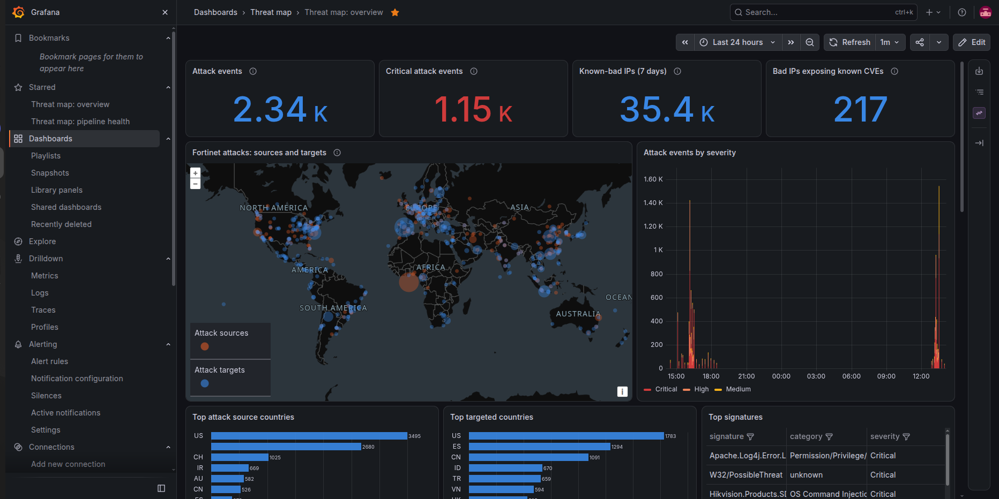
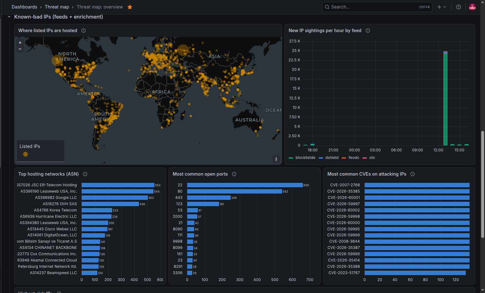
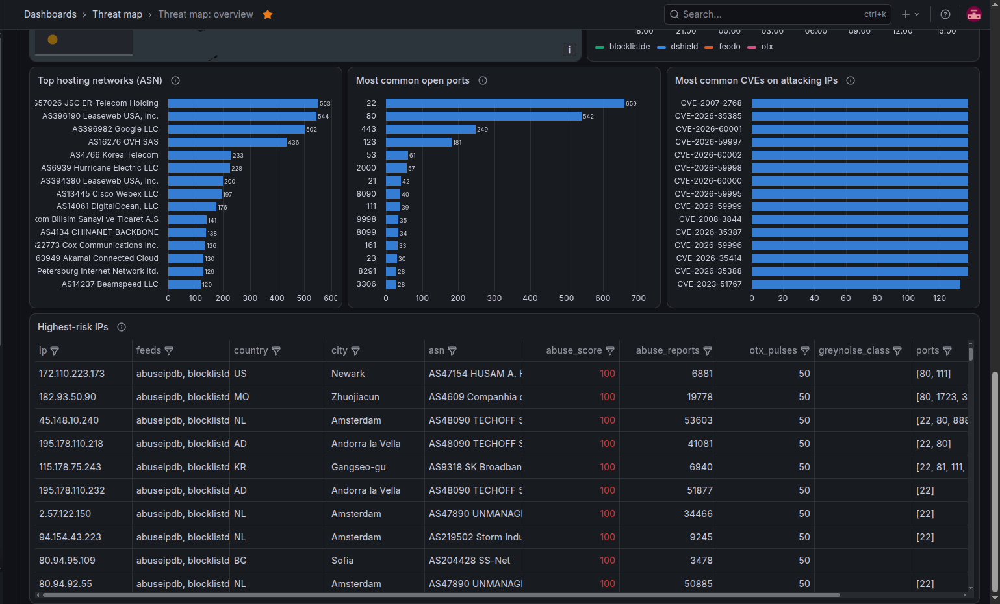
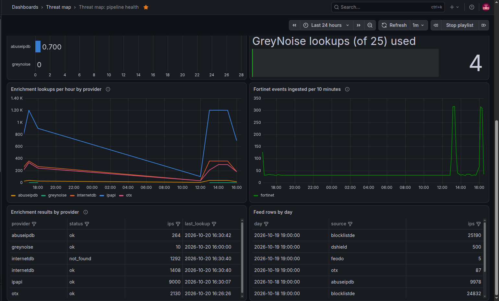

# Threat map dashboards

Grafana dashboards for the database loaded by [`n8n/threatmap-feeds`](../../n8n/threatmap-feeds).

- `overview.json` (**Threat map: overview**) shows a map of Fortinet attack sources and targets, severity, top source and target countries, signatures, hosting ASNs, open ports, CVEs on attacking IPs and the highest-risk IPs.
- `pipeline.json` (**Threat map: pipeline health**) shows ingest status, stale sources, enrichment coverage, API quota used today, database size and feed volume.

## Screenshots

### Threat map overview







### Pipeline health



## Import

1. Add a **PostgreSQL** data source pointing at the `threatmap` database. A read-only user such as `grafana_ro`, created by [`postgres/threatmap/02-grafana-ro.sh`](../../postgres/threatmap/02-grafana-ro.sh), is recommended. Grafana's `-slim` image needs the `grafana-postgresql-datasource` plugin installed.
2. Go to **Dashboards → New → Import**, upload a JSON file, and choose that data source for *Threatmap Postgres*.

## Provisioning instead

To provision rather than import, replace `${DS_THREATMAP}` in each file with your data source's uid, delete the `__inputs` and `__requires` blocks, and add a data source like this:

```yaml
apiVersion: 1
datasources:
  - name: Threatmap
    type: grafana-postgresql-datasource
    uid: threatmap
    url: threatmap-postgres:5432
    user: grafana_ro
    jsonData: { database: threatmap, sslmode: disable }
    secureJsonData:
      password: $__file{/run/secrets/grafana_ro_password}
```
