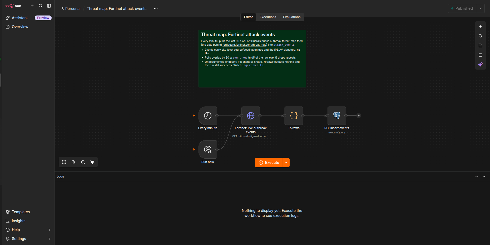
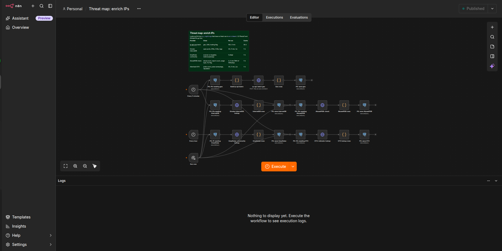

# Threat map feeds

Three n8n workflows that load public threat data into Postgres. The schema is in [`postgres/threatmap`](../../postgres/threatmap). The data drives the [Grafana dashboards](../../grafana/threatmap), and you can build a threat globe or map on top of it. AbuseIPDB and AlienVault OTX need API keys, which are free. The other sources need no key.

| Workflow | Schedule | Source | Table |
|---|---|---|---|
| Threat map: Fortinet attack events | every minute | FortiGuard outbreak threat map (city-level arcs, no IPs) | `attack_events` |
| Threat map: IP feeds | hourly / daily | DShield top 500 attackers, Feodo Tracker C2s, blocklist.de (~25k IPs), OTX subscribed pulses, AbuseIPDB blacklist (10k IPs, daily) | `ip_sightings` |
| Threat map: enrich IPs | 5 min / hourly | ip-api.com geo, Shodan InternetDB ports and CVEs, GreyNoise community, AbuseIPDB check, OTX pulse count | `enrichment` |

## Workflow screenshots





Repeats are dropped in SQL. Enrichment is cached per IP and provider, for 30 days for geo and 7 days for the others, so quotas are never spent twice on the same IP. A 429 or 5xx response is not cached, so that IP is retried on a later run.

## Setup

1. Create the database from [`postgres/threatmap`](../../postgres/threatmap). n8n must be able to reach it. The credential's host defaults to `threatmap-postgres`.
2. Create these credentials, using the names in `credentials.placeholder.json`:
   - **Threatmap Postgres.** User `threatmap`, database `threatmap`.
   - **AbuseIPDB API key (Key).** Header Auth, header name `Key`.
   - **AlienVault OTX API key (X-OTX-API-KEY).** Header Auth, header name `X-OTX-API-KEY`.
3. Import `workflow-fortinet.json`, `workflow-feeds.json` and `workflow-enrich.json`, then activate them.

## Checking data is arriving

```sql
select * from ingest_health order by source;
```

Every source should show a recent `last_ingested`. The `ip_profile` view gives one row per IP, combining its feeds, geo, ASN, open ports, CVEs and GreyNoise class.

## Notes

- The Fortinet endpoint is undocumented. If its response shape changes, *To rows* outputs nothing and the run still succeeds, so keep an eye on `ingest_health`.
- ip-api's free tier is HTTP only and limited to non-commercial use.
- GreyNoise without a key allows 25 lookups a day, which is why it runs hourly.
- AbuseIPDB's free plan allows 5 blacklist downloads a day, and each *Run now* on the feeds workflow uses one.
- OTX only returns pulses from authors your account follows. Follow more authors to widen the feed.
- Retention: `attack_events` are kept for 30 days and `ip_sightings` for 90 days.
- IPv4 only.
- Requests send the User-Agent `n8n-threatmap/0.1`. Change it to identify yourself.
